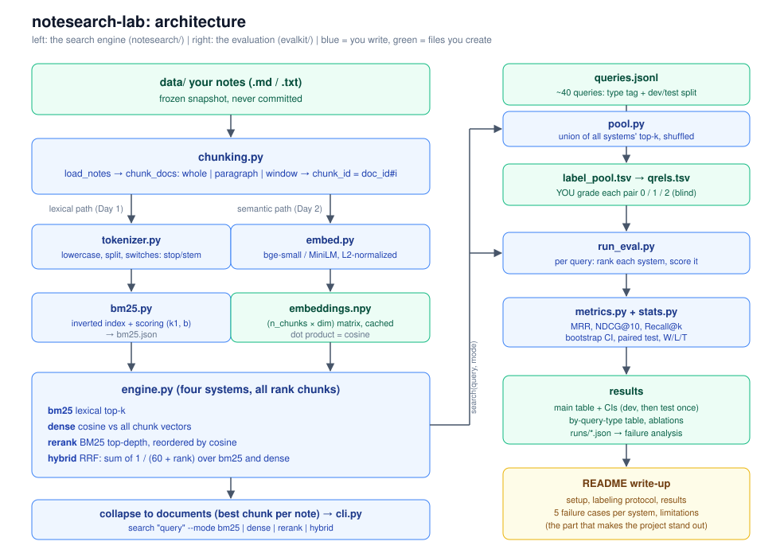

# Architecture



Two packages with one dependency direction: `evalkit` imports `notesearch`, never the reverse.

```
data/ notes ──► chunking ──┬─► tokenizer ──► bm25 index ──┐
                           │                              ├─► engine (bm25 | dense | rerank | hybrid) ──► cli
                           └─► embedder ──► embeddings ───┘                    │
                                                                               ▼
queries.jsonl ─► pool ─► (you label) ─► qrels.tsv ─► run_eval ─► metrics + stats ─► tables, runs/*.json ─► write-up
```

## Modules and their one job

| module | job | depends on |
|---|---|---|
| `notesearch/chunking.py` | notes on disk → `Doc` → `Chunk` (whole / paragraph / window) | stdlib |
| `notesearch/tokenizer.py` | text → terms (same code for docs and queries) | stdlib (+ nltk optional) |
| `notesearch/bm25.py` | inverted index, BM25 scoring, save/load | nothing else |
| `notesearch/embed.py` | text → normalized vectors | sentence-transformers |
| `notesearch/engine.py` | build/load an index folder; the 4 retrieval modes; chunk → doc collapse | all of the above |
| `notesearch/cli.py` | `index` and `search` commands | engine |
| `evalkit/io.py` | read `queries.jsonl` and `qrels.tsv` | stdlib |
| `evalkit/metrics.py` | MRR, NDCG, Recall, Precision for one query | nothing |
| `evalkit/stats.py` | bootstrap CI, paired bootstrap, win/loss/tie | numpy |
| `evalkit/pool.py` | build the shuffled, system-blind label pool | engine, io |
| `evalkit/run_eval.py` | run systems over queries, print tables, save per-query JSON | engine, metrics, stats, io |

## Data formats

**Index folder** (one per chunking config, e.g. `idx_paragraph/`)
- `meta.json`: chunking config, model name, tokenizer config, chunk count
- `chunks.jsonl`: one `{chunk_id, doc_id, text}` per line, in index order
- `bm25.json`: k1, b, doc lengths, postings (`term -> [[chunk_idx, tf], ...]`)
- `embeddings.npy`: float32 matrix, row `i` = chunk `i`

**`queries.jsonl`**: `{"id","text","type","split"}`, type in `keyword | question | vague | exact | paraphrase`, split in `dev | test`

**`qrels.tsv`**: `query_id<TAB>doc_id<TAB>grade`, grade 0/1/2. Missing pair = unjudged = counted as 0.

## The four systems

| mode | candidates | final order | note |
|---|---|---|---|
| `bm25` | all chunks with a query term | BM25 score | baseline |
| `dense` | all chunks | cosine similarity | catches paraphrase, may miss exact tokens |
| `rerank` | BM25 top-`depth` chunks | cosine similarity | ceiling = BM25 recall at `depth` |
| `hybrid` | BM25 top-`depth` ∪ dense top-`depth` | RRF: Σ 1/(60 + rank) | no score normalization needed |

After ranking chunks, collapse to documents by keeping each note's best-ranked chunk. The eval scores documents, because that is what a labeler judges.

## Decisions to make early and write down

1. **Doc-level vs chunk-level eval.** Default: doc-level (max over chunks).
2. **Unjudged = irrelevant.** Standard, but biased against systems that find unjudged-but-good notes. State it.
3. **NDCG gain.** Linear (grade) or exponential (2^grade − 1). Pick one, report it.
4. **IDF form.** Non-negative `log(1 + (N − df + 0.5)/(df + 0.5))`. The tests assume this.
5. **Tokenizer defaults.** Off for stemming and stopwords; those are ablations.
6. **Dev/test split.** Fixed on Day 1. Tune on dev only. Run test once.

## Interfaces the tests and the CLI rely on

```python
Tokenizer(stopwords=False, stem=False, keep_compounds=True)(text) -> list[str]
BM25Index(k1, b).build(list[list[str]]) -> self
BM25Index.search(query_tokens, k) -> [(doc_idx, score)]
Engine.build(folder, out_dir, chunking, model, ...) / Engine.load(index_dir)
Engine.search(query, mode, k, depth, rrf_k, level) -> [{"rank","doc_id","chunk_id","score","text"}]
ndcg_at_k(ranked_doc_ids, {doc_id: grade}, k, gain) -> float
bootstrap_ci(values) -> (mean, lo, hi);   paired_bootstrap(a, b) -> {"diff","lo","hi","p"}
```
